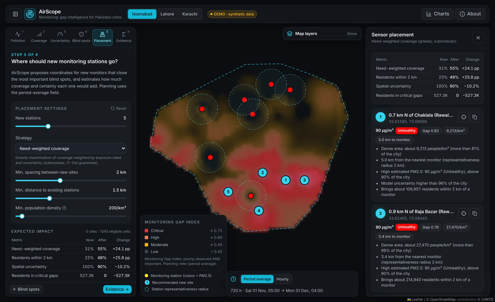
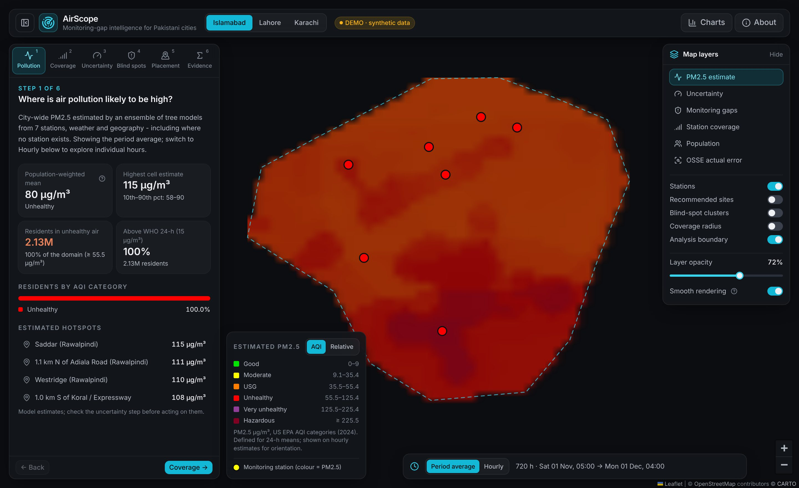
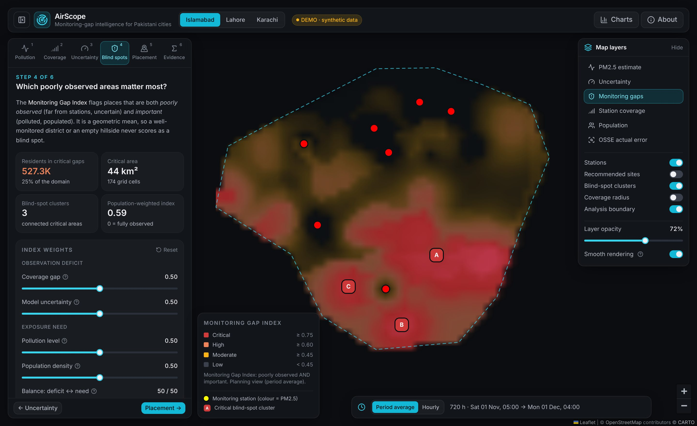

# AirScope

**AI-driven monitoring-gap discovery and optimal sensor placement for urban air quality in Pakistan.**

Many Pakistani cities run only a handful of PM2.5 monitors, so most residents live
kilometres from the nearest measurement. AirScope estimates air quality across the
whole city, shows **where the city is effectively blind**, and recommends **exact
coordinates for new monitoring stations**, quantifying how much each one would improve
coverage and certainty.

> **Honesty first.** The bundled offline demo runs on a documented **synthetic** dataset
> (an *Observing System Simulation Experiment*, section [How the demo works](#how-the-demo-works)).
> It never presents synthetic numbers as real observations, and every metric is computed
> by the pipeline and labelled with its data provenance. With a free OpenAQ key, the
> same pipeline runs on live measurements.



<sub>Screenshots were rendered in a sandbox without internet access, so the CARTO basemap is absent; with internet, streets and place names appear beneath the data layers.</sub>

---

## What AirScope answers

| Question | How AirScope answers it |
|---|---|
| Where is air pollution likely to be high? | A tree-model ensemble estimates PM2.5 on a 0.5-0.75 km grid from sparse stations, weather and geography |
| Where is monitoring coverage insufficient? | Probabilistic station coverage and distance-to-monitor maps; residents within 2 km of a monitor |
| Where is the model uncertain? | Calibrated 90 % intervals that grow away from stations (kriging-variance term + conformal calibration) |
| Which blind spots matter most? | The **Monitoring Gap Index**: poorly observed *and* important (polluted, populated), with ranked blind-spot clusters |
| Where should new stations go? | Greedy optimisation of need-weighted coverage (submodular, (1−1/e) guarantee without constraints) or kriging-variance reduction, with siting constraints |
| How much would coverage improve? | Before/after metrics, a diminishing-returns curve, what-if simulation of your own sites, and (demo) a test against the synthetic truth |

The **core innovation** is the last three rows: turning a sparse network's uncertainty
into concrete, explainable siting decisions.

| | |
|---|---|
|  |  |
| Estimated PM2.5 with hotspots and residents per AQI category | Monitoring Gap Index with critical blind-spot clusters and adjustable weights |

## Quick start

Requirements: **Python 3.11+**, **Node.js 18+** with npm. No API keys. After
installation everything runs offline (map tiles need internet; the data do not).

```bash
make start
```

This creates `backend/.venv`, installs dependencies, builds the web interface and serves
everything at **http://127.0.0.1:8000**. On first start, each city's model is trained in
the background (about a minute per city; the UI shows progress). Results are cached in
`backend/models/` and reused.

Other entry points:

```bash
make dev          # backend :8000 + Vite hot-reload UI on http://127.0.0.1:5173
```

```bash
make test         # 100+ backend tests (offline) + frontend type-check and unit tests
```

```bash
make train        # train all cities ahead of time (full profile, with OSSE benchmark)
```

```bash
make report       # regenerate docs/demo_results.md from the trained models' metrics
```

<details>
<summary>Manual setup (Windows or without make)</summary>

```bash
cd backend
python -m venv .venv
.venv/bin/python -m pip install -r requirements.txt -r requirements-optional.txt
.venv/bin/python app.py
```

On Windows use `.venv\Scripts\python` instead of `.venv/bin/python`. In a second terminal:

```bash
cd frontend
npm install
npm run dev
```

Open http://127.0.0.1:5173. (`npm run build` produces `frontend/dist`, which the backend then serves at http://127.0.0.1:8000.)
</details>

### Live data (optional)

1. Get a free OpenAQ v3 API key at https://explore.openaq.org/register.
2. `cp backend/.env.example backend/.env`, then set `AIRSCOPE_DATA_MODE=live` and `OPENAQ_API_KEY=...`.
3. Restart. AirScope fetches the last 14 days of hourly PM2.5 (OpenAQ) and weather
   (Open-Meteo, no key), trains on them and labels everything **LIVE**. If a fetch
   fails it uses the last good live response (labelled *stale*) or falls back to the
   demo dataset - and says so in the UI and API.

## How it works

```mermaid
flowchart LR
  A[OpenAQ v3 / synthetic stations] --> Q[Quality control<br/>range, stuck, spike, completeness]
  W[Open-Meteo / synthetic weather] --> Q
  G[Population, elevation, boundaries] --> F
  Q --> F[Features<br/>space · time · weather · other stations]
  F --> M[Ensemble<br/>RF + HGB + XGBoost]
  M --> V[LOSO validation<br/>vs IDW / network-mean baselines]
  V --> U[Uncertainty<br/>quantiles + spread + kriging variance<br/>+ conformal calibration]
  M --> E[City-wide grid estimate]
  U --> GI[Monitoring Gap Index<br/>deficit^α · need^(1-α)]
  E --> GI
  GI --> P[Greedy sensor placement<br/>coverage / kriging variance]
  P --> I[Impact: coverage, uncertainty,<br/>critical gaps, curve, what-if]
  P --> O[OSSE benchmark<br/>demo only]
```

* **Validation is spatial.** Leave-one-station-out CV answers "how wrong are we where
  there is no station?" and is always compared with simple baselines. The app states
  plainly when a baseline does as well (it does in two of the three demo cities at held-out
  stations).
* **Uncertainty is calibrated and checked.** Tree models alone are over-confident away from
  stations; AirScope adds a kriging-variance term from the station layout and verifies
  interval coverage with nested LOSO (and, in the demo, at every grid cell).
* **Placement is explainable.** Every recommended site comes with its reasons (density,
  distance to the nearest monitor, estimated PM2.5, uncertainty, residents newly covered).

Full details, equations, ablations and references: **[docs/methodology.md](docs/methodology.md)**.

## How the demo works

The offline demo is an **Observing System Simulation Experiment (OSSE)**, the method
meteorological agencies use to design observing networks. A documented synthetic
"nature run" defines PM2.5 everywhere: ventilation-driven night-time peaks, industrial,
traffic and brick-kiln plumes that follow the wind, cleaner air on the Margalla Hills and the
Karachi coast, plus local structure no covariate explains. Simulated stations sample it with
realistic noise, gaps and faults. AirScope only ever sees those samples, but because the
truth is known everywhere we can score what real data cannot: the error of the whole map,
whether the uncertainty is honest, and how much each placement strategy *actually* helps.

Computed results for the three demo cities are in **[docs/demo_results.md](docs/demo_results.md)**
(generated from the model artifacts by `make report`). Headlines, all on synthetic data:

* Held-out (LOSO) error: the ensemble beats simple interpolation in Karachi, but not at
  Islamabad's or Lahore's held-out stations. On the full synthetic truth it matches or beats
  IDW everywhere, clearly so in Lahore.
* Calibration: nested-LOSO coverage of 90 % intervals is 86-89 %, versus 43-75 % for the tree
  models' own spread.
* Placement: in Karachi, five AirScope sites cut city-wide error far more than any of five random
  placements. In Lahore, extra stations in polluted hotspots did **not** reduce city-wide
  error because of *preferential sampling* - a finding documented in the methodology rather than
  hidden.

## Project structure

```
AirScope/
├── backend/                 Flask API + ML engine (Python 3.11)
│   ├── app.py               entry point (serves frontend/dist when built)
│   ├── config.py            settings (.env) and city registry
│   ├── api/                 routes.py (endpoints), schemas.py (validation/serialisation)
│   ├── services/            analysis orchestration, model registry with background training
│   ├── data/                OpenAQ + Open-Meteo clients, cache, QC, dataset service, synthetic nature run
│   ├── ml/                  features, train, predict, uncertainty, gaps, sensor_placement, evaluation, osse, ablation, report
│   ├── geospatial/          distances, city grid, polygons, surfaces, gazetteer
│   ├── datasets/            bundled boundaries, demo stations, localities, surfaces, synthetic profiles
│   ├── cache/               bundled offline demo datasets (<city>_demo.json); live cache at runtime
│   ├── models/              trained artifacts (generated)
│   └── tests/               pytest suite (offline, fixtures for live APIs)
├── frontend/                React + Vite + TypeScript + Tailwind + React Leaflet + Recharts
│   └── src/                 components/, components/steps/, components/charts/, hooks/, services/, state/, types/, utils/
├── docs/                    methodology, API, data & licensing, adding a city, generated demo results
├── scripts/start.sh         one-command launcher
└── Makefile
```

## Configuration

All optional; set in `backend/.env` (see `backend/.env.example`).

| Variable | Default | Purpose |
|---|---|---|
| `AIRSCOPE_DATA_MODE` | `demo` | `demo`, `live` or `auto` |
| `OPENAQ_API_KEY` | - | free OpenAQ v3 key (live mode) |
| `AIRSCOPE_LIVE_HISTORY_DAYS` | 14 | days of live history to fetch (2-90) |
| `AIRSCOPE_TRAINING_PROFILE` | `full` | `full` (LOSO, importance, OSSE) or `fast` |
| `AIRSCOPE_TRAIN_ON_STARTUP` | `true` | train missing or stale models in the background |
| `AIRSCOPE_COORDINATE_FEATURES` | `false` | also feed raw lat/lon to the models (see methodology §10) |
| `AIRSCOPE_HOST` / `AIRSCOPE_PORT` | `127.0.0.1` / `8000` | server address |

## Documentation

* [Methodology](docs/methodology.md) - data, features, model, validation, uncertainty, gap index, placement, OSSE, ablations, limitations, references
* [API reference](docs/api.md)
* [Data sources & licensing](docs/data_sources_and_licensing.md)
* [Adding a city](docs/adding_a_city.md)
* [Generated demo results](docs/demo_results.md)
* [Backend README](backend/README.md) · [Frontend README](frontend/README.md)

## Responsible use and limitations

* Demo results come from a synthetic city and demonstrate the methodology, not real-world accuracy.
* With seven mostly central stations, any spatial model is weakly constrained; AirScope reports
  this through held-out errors and wide intervals far from stations.
* Bundled population, elevation, boundaries and locality coordinates are documented
  approximations; replace them with WorldPop/GHSL, a DEM and official boundaries for real planning.
* The representativeness radius, gap-index weights and siting constraints are policy choices,
  exposed as parameters.
* Recommended coordinates are candidates for a field survey; power, access, security and
  permissions decide final siting.
* The AQI is defined for 24-hour means; hourly categories are shown for orientation only.

## Roadmap

* Preferential-sampling-aware estimation (e.g. residual kriging or declustering weights), so new
  hotspot stations never degrade estimates elsewhere.
* Low-cost-sensor calibration (humidity correction) for live OpenAQ data.
* Satellite AOD and land-use covariates; real WorldPop/GHSL population and Copernicus DEM layers.
* Multi-week planning views and seasonal (smog-season) placement scenarios.
* More cities (Peshawar, Faisalabad, Multan, Quetta) via `docs/adding_a_city.md`.

## Licence

The code and bundled data were written for this project. Choose and add a licence before
publishing (MIT is a common choice for competition submissions). Third-party data and
software keep their own licences - see [docs/data_sources_and_licensing.md](docs/data_sources_and_licensing.md).
